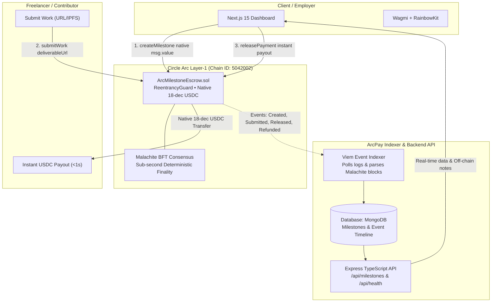

# ArcPay ⚡ — Global Freelance Milestone Escrow & Instant USDC Payroll

Built on **Circle's Arc Layer-1 Testnet** with sub-second **Malachite BFT** deterministic finality and native **18-decimal USDC**.

-0066FF?style=for-the-badge&logo=circle&logoColor=white)

-6366F1?style=for-the-badge)

---

## 🌐 Circle Arc Testnet Specifications

Arc is Circle's dedicated Layer-1 blockchain engineered specifically for institutional and global financial applications, powered by the Malachite BFT consensus engine:

| Parameter | Value |
| :--- | :--- |
| **Network Name** | Arc Testnet |
| **Chain ID** | `5042002` (`0x4cef52`) |
| **RPC URL** | `https://rpc.testnet.arc.io` |
| **Block Explorer** | [https://explorer.testnet.arc.io](https://explorer.testnet.arc.io) |
| **Native Gas Token** | `USDC` |
| **Native Token Decimals** | **18 decimals** for `msg.value` and `getBalance` *(unlike 6-decimal wrapped ERC-20)* |
| **Consensus / Finality** | Sub-second deterministic finality (Malachite BFT) |
| **Circle Testnet Faucet** | [https://faucet.circle.com](https://faucet.circle.com) |

> ⚠️ **CRITICAL NOTE ON ARC NATIVE USDC:**
> On Circle Arc Layer-1, native USDC operates as the native gas token and uses **18 decimals** when transferred via `msg.value` or checked via `getBalance`. ArcPay leverages native `msg.value` transfers directly for maximum gas efficiency, instant settlement, and reentrancy safety.

---

## 🏛️ System Architecture



---

## 📁 Repository Structure

```
Arc/
├── contracts/                     # Solidity smart contracts & test suites
│   ├── src/
│   │   └── ArcMilestoneEscrow.sol # Canonical contract source
│   ├── test/
│   │   ├── ArcMilestoneEscrow.test.ts # Hardhat unit tests (21 passing)
│   │   └── ArcMilestoneEscrow.t.sol   # Foundry test suite
│   ├── scripts/
│   │   └── deploy.ts              # Arc Testnet deployment script
│   ├── script/
│   │   └── Deploy.s.sol           # Foundry deployment script
│   ├── hardhat.config.ts          # Configured for Arc Testnet (5042002)
│   ├── foundry.toml               # Foundry profile for Arc Testnet
│   ├── package.json
│   └── .env.example
│
├── backend/                       # Node.js + Express + TypeScript + viem Indexer
│   ├── src/
│   │   ├── index.ts               # Express server & /api/health endpoint
│   │   ├── db.ts                  # Unified database interface (MongoDB)
│   │   ├── db/                    # MongoDB database adapter
│   │   │   ├── types.ts           # DatabaseAdapter interface definition
│   │   │   ├── mongoAdapter.ts    # Official MongoDB driver implementation
│   │   │   └── stats.ts           # 18-decimal financial metrics calculator
│   │   ├── indexer.ts             # Viem log watcher on Arc Testnet
│   │   ├── arcChain.ts            # Custom Arc Testnet Viem definition & ABI
│   │   ├── types.ts               # TypeScript data interfaces
│   │   └── routes/
│   │       └── milestones.ts      # REST API endpoints
│   ├── package.json
│   ├── tsconfig.json
│   └── .env.example
│
├── frontend/                      # Next.js 15 App Router + Tailwind + RainbowKit
│   ├── src/
│   │   ├── app/
│   │   │   ├── layout.tsx         # Root layout with metadata
│   │   │   ├── page.tsx           # Main dashboard page
│   │   │   ├── providers.tsx      # Wagmi + RainbowKit providers
│   │   │   └── globals.css        # Slate/Circle dark fintech aesthetic
│   │   ├── components/
│   │   │   ├── Navbar.tsx         # ConnectButton & live 18-dec USDC balance
│   │   │   ├── OverviewMetrics.tsx# Active Locked, Paid Out, Finality cards
│   │   │   ├── MilestoneDashboard.tsx # Role tabs: Client / Freelancer
│   │   │   ├── MilestoneCard.tsx  # Interactive milestone card with actions
│   │   │   ├── CreateMilestoneModal.tsx # Lock native USDC in escrow
│   │   │   ├── SubmitWorkModal.tsx      # Deliverable URL / IPFS submission
│   │   │   ├── MilestoneDetailsModal.tsx# Event timeline & audit logs
│   │   │   └── EmptyState.tsx
│   │   ├── config/
│   │   │   ├── arcChain.ts        # Custom chain definition for Wagmi/Viem
│   │   │   ├── wagmi.ts           # RainbowKit + Wagmi config
│   │   │   └── contracts.ts       # Typed ABI & contract address
│   │   ├── lib/
│   │   │   ├── api.ts             # Backend API client
│   │   │   └── utils.ts           # 18-decimal formatUSDC & helpers
│   │   └── types/
│   │       └── index.ts
│   ├── package.json
│   ├── tailwind.config.ts
│   ├── next.config.ts
│   └── .env.example
│
└── README.md
```

---

> Each folder is a standalone npm project with its own `package.json` and `package-lock.json`. There is no root workspace — install and run commands from inside the folder you are working on.

---

## ⚡ Quick Start Guide

### 1. Prerequisites
- **Node.js**: v18.0.0 or higher (v22 recommended)
- **npm** or **pnpm**
- An EVM-compatible browser wallet (e.g. MetaMask, Rabby, Rainbow)
- Testnet USDC from the official [Circle Faucet](https://faucet.circle.com) (select Arc Testnet)

---

### 2. Smart Contracts (`/contracts`)

#### Install Dependencies
```bash
cd contracts
npm install
```

#### Run Unit Tests
```bash
npm test
```
*Output: 21 comprehensive unit tests passing with full gas consumption metrics.*

#### Configure Arc Testnet Deployment
Create `contracts/.env` from the example:
```bash
cp .env.example .env
```
Edit `contracts/.env` with your deployer private key:
```ini
PRIVATE_KEY=0xYOUR_TESTNET_PRIVATE_KEY
ARC_TESTNET_RPC=https://rpc.testnet.arc.io
```

#### Deploy to Arc Testnet
```bash
npm run deploy:arc
```
The script will output:
```
================ Deployment Summary ================
Contract Address : 0x...
Transaction Hash : 0x...
Arc Explorer     : https://explorer.testnet.arc.io/address/0x...
====================================================
```
Copy the deployed contract address.

---

### 3. Backend Indexer & Metadata API (`/backend`)

#### Install Dependencies & Build
```bash
cd ../backend
npm install
npm run build
npm test
```

#### Configure Environment
Create `backend/.env`:
```bash
cp .env.example .env
```
Edit `backend/.env` and paste your deployed contract address:
```ini
PORT=3001
ARC_TESTNET_RPC=https://rpc.testnet.arc.io
ESCROW_CONTRACT_ADDRESS=0xYOUR_DEPLOYED_CONTRACT_ADDRESS

# MongoDB Configuration
MONGODB_URI=mongodb://127.0.0.1:27017
MONGODB_DB_NAME=arcpay

POLL_INTERVAL_MS=3000
INDEXER_START_BLOCK=0
```
After deployment, set `INDEXER_START_BLOCK` to the contract deployment block shown in its Arc Explorer transaction receipt. Leaving it at `0` requests a full-history backfill and can delay initial indexing.

#### Start the Backend
```bash
npm run dev
# or in production:
npm start
```
Check health:
```bash
curl http://localhost:3001/api/health
```
Response:
```json
{
  "status": "healthy",
  "network": "Arc Testnet",
  "chainId": 5042002,
  "liveBlockHeight": "73008441",
  "contractAddress": "0x..."
}
```

---

### 4. Next.js 15 (v15.5.29) Frontend (`/frontend`)

#### Configure Environment
Create `frontend/.env.local`:
```bash
cd ../frontend
cp .env.example .env.local
npm install
```
Edit `frontend/.env.local`:
```ini
NEXT_PUBLIC_ESCROW_CONTRACT_ADDRESS=0xYOUR_DEPLOYED_CONTRACT_ADDRESS
NEXT_PUBLIC_ARC_RPC_URL=https://rpc.testnet.arc.io
NEXT_PUBLIC_ARC_EXPLORER_URL=https://explorer.testnet.arc.io
NEXT_PUBLIC_API_URL=http://localhost:3001
NEXT_PUBLIC_WALLETCONNECT_PROJECT_ID=YOUR_WALLETCONNECT_PROJECT_ID
```

#### Start Development Server
```bash
npm run dev
```
Open **[http://localhost:3000](http://localhost:3000)** in your browser.

---

## 🚀 Deployment

Each app is deployed independently. Smart contracts are already deployed to Arc Testnet (see `contracts/deployments/arcTestnet.json`).

### Frontend → Vercel
1. Import this repository into Vercel.
2. Set **Root Directory** to `frontend`.
3. Add the `NEXT_PUBLIC_*` variables from `frontend/.env.example`.
4. Vercel runs `npm install` and `npm run build` inside `frontend`.

### Backend → long-running Node host (Render / Railway / Fly / VPS)
Vercel serverless functions cannot keep the indexer's polling loop alive, so host the backend on a platform that supports long-running processes.
1. Set the project/working directory to `backend`.
2. Build command: `npm install && npm run build`
3. Start command: `npm start`
4. Add the variables from `backend/.env.example` (MongoDB URI, contract address, RPC URL).

### Contracts → Arc Testnet
Already deployed. To redeploy from `contracts/`:
```bash
npm install
npm run deploy:arc
```

---

## 🔄 User Workflow & Lifecycle

1. **Connect Wallet:**
   - Click "Connect Wallet" in the navbar.
   - The app automatically registers and prompts you to switch to **Arc Testnet** (`Chain ID: 5042002`).
   - If your balance is 0, click the **"Circle Faucet"** pill to request native testnet USDC.

2. **Employer / Client Flow:**
   - Click **"Fund Milestone"** or **"New Escrow"**.
   - Input the freelancer's `0x` address, milestone title, deadline, and USDC amount (e.g. `50.00 USDC`).
   - Confirm transaction: `parseUnits(amount, 18)` is locked into `ArcMilestoneEscrow` via `msg.value`.
   - The dashboard updates immediately after Malachite BFT finality (<1s).

3. **Freelancer Flow:**
   - The freelancer switches to the **"As Freelancer"** tab to see assigned milestones.
   - Once work is ready, click **"Submit Work"** and provide a GitHub PR, Figma URL, or IPFS link.
   - Milestone status updates to `Submitted`.

4. **Approval & Instant Settlement:**
   - The client reviews the deliverable URL.
   - Click **"Approve & Instant Pay"**.
   - `releasePayment(id)` transfers the locked 18-decimal native USDC directly to the freelancer's wallet.
   - Sub-second deterministic finality confirms the payout in <1s with celebration animation!

5. **Refund Safeguards:**
   - Freelancers can voluntarily cancel and refund the client at any time (`refundClient`).
   - If a milestone expires past its deadline without submitted work, the client can reclaim locked funds unilaterally.

---

## 🛡️ Security Features
- **Reentrancy Protection:** All state changes occur before external `call{value: ...}` transfers using OpenZeppelin's `ReentrancyGuard`.
- **Role Verification:** Strict checks (`OnlyClient`, `OnlyFreelancer`) ensure unauthorized addresses cannot alter milestones or intercept funds.
- **Sub-Second Deterministic Finality:** Malachite BFT consensus guarantees zero re-org risks once a transaction receipt is generated.
- **Fail-Safe Contract Reads:** The frontend includes an automatic contract read fallback so that user dashboards function seamlessly even if off-chain indexing services are restarting.

---

## 📜 License
MIT © ArcPay Team & Circle Arc Community.
